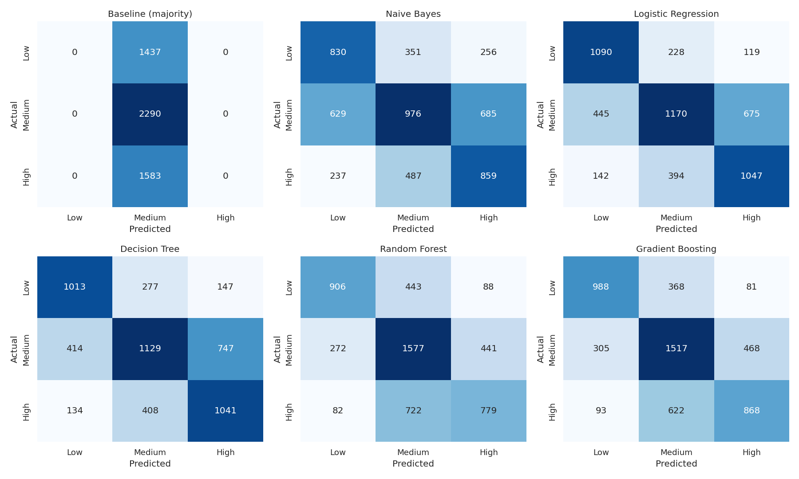
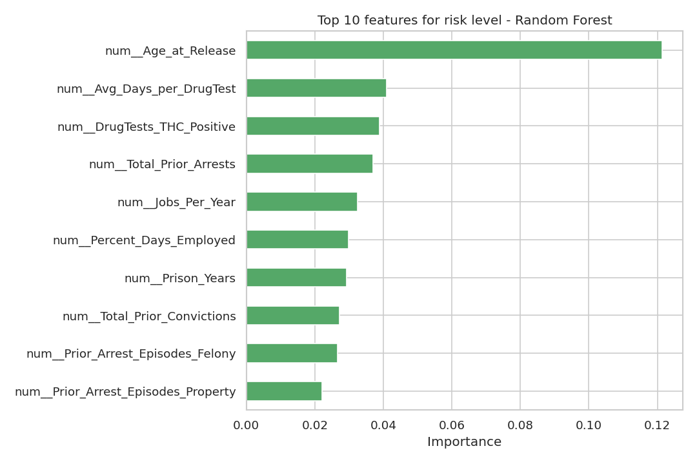

# Risk Research Assistant (ML Project)

A machine learning project that predicts a person's **supervision risk level (Low / Medium / High)** from the NIJ recidivism dataset. It compares six models, tunes them with cross-validation, and ends with a small command-line checker where you enter an ID and get the predicted risk level.

> This is a student project for learning. It is **not** a real decision-making tool.

## Project structure

```
risk-research-assistant-ml-project/
├── src/
│   └── risk_research_assistant.py
├── notebooks/
│   └── risk_research_assistant_ml_project.ipynb
├── data/                          
├── outputs/                          
├── docs/figures/                     
├── requirements.txt
└── README.md
```

## Setup

```bash
git clone https://github.com/roshaanumar/risk-research-assistant-ml-project
cd risk-research-assistant-ml-project
python -m venv .venv
pip install -r requirements.txt
```

Place `NIJ_DataSet.csv` in `data/`, then run `python src/risk_research_assistant.py` or open the notebook.

## Pipeline

- Data cleaning and target grouping: risk score 1–4 = Low, 5–7 = Medium, 8–10 = High.
- Feature engineering, exploratory data analysis, and stratified 70/30 train-test split.
- Six models, tuned with 5-fold GridSearchCV on macro F1.
- Evaluation includes accuracy, macro precision/recall/F1, ROC-AUC, confusion matrices, ROC/PR curves, and feature importance.
- ID-based risk checker with class probabilities.

Leakage columns (risk score, supervision level, recidivism outcomes) are excluded from model inputs.

## Test-set results

| Model | Accuracy | F1 (macro) | ROC-AUC |
|---|---:|---:|---:|
| Baseline (majority) | 0.4313 | 0.2009 | 0.5000 |
| Naive Bayes | 0.5019 | 0.5044 | 0.6874 |
| Logistic Regression | 0.6228 | 0.6283 | 0.8029 |
| Decision Tree | 0.5994 | 0.6059 | 0.7726 |
| Random Forest | 0.6143 | 0.6125 | 0.7992 |
| **Gradient Boosting** | **0.6352** | **0.6370** | **0.8125** |

Gradient Boosting had the best cross-validated macro F1 (0.6358). Age at release was the most important Random Forest feature.




Tech: Python, pandas, NumPy, scikit-learn, matplotlib, seaborn.
